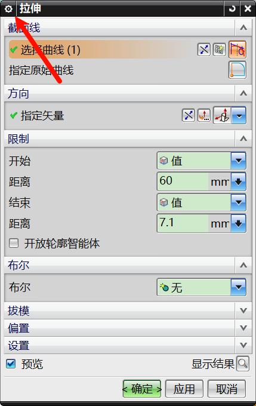

# UG 逆向设计

## 柱形壳盖逆向

### STL 文件导入、编辑与定位基准（一）

- "文件"→"导入"→STL 文件
- 避免部件颜色晃眼，选择灰度高的颜色，`Ctrl+J`：编辑对象显示
- 先选择对象，进行草图绘制，确定基准面→"基准坐标系"
  - 画出大致的两个轴，让基准坐标系的两个轴与其对齐
- 移动到坐标系："工具"→"移动对象"→"运动"选择"坐标系到坐标系"，对象选择部件和两个对应基准坐标系的面
- 坐标系校准：进行圆绘制，圆心确定原点的位置，以圆心为原点进行之前的操作，得到另一个坐标系，"工具"→"移动对象"→"运动"选择"坐标系到坐标系"，对象先选择后一个，即可确定原点的坐标

## 逆向铺设直面

直面：没有曲率的面，可以展开，例如揉成一团的纸。

选择"拉伸"，注意里面可能少了很多选项，点击弹出的选项框左上角的"齿轮"按钮，选择"拉伸（更多）"即可显示，更多功能都是如此操作。

- "设置"→"体类型"：将"实体"设置为"片体"
- "拔模"→"从起始位置"：0.5°

## 拟合曲面

- "逆向工程"→"检测体素"→"曲率灵敏度"
- "逆向工程"→"拟合曲面"→"颜色编码区域"
- "参数化"→"次数"：控制拟合度
- "光顺因子"：越小，几何误差越小，拟合精度越高，但是看着会更不"平顺"
- 右键背景轮盘："带边着色"
- 判断拟合的曲面质量："曲面"→"扩大"各方向调大，看拟合的曲面是否光整
- 如若质量不行，"参数化"→"次数"减小
