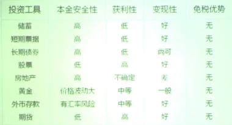
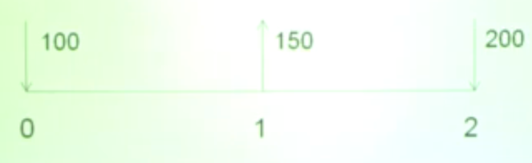
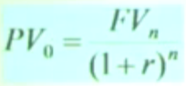
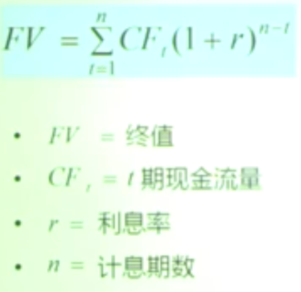
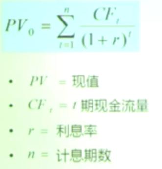
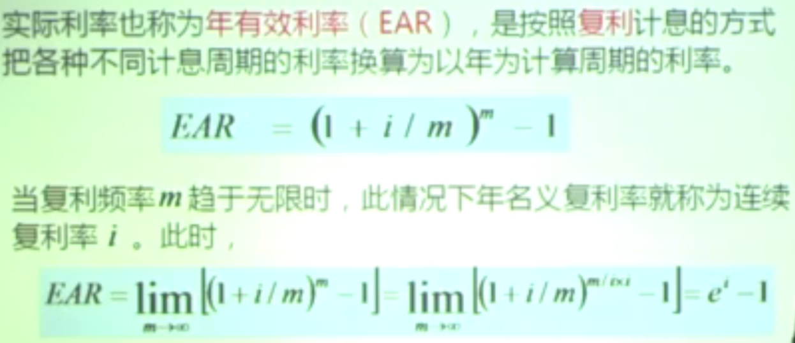

# 家庭理财知识体系

## 一、基本观念

1. **误区**：理财是富人、高收入家庭的专利。事实上，影响未来财富的关键因素是投资回报率的高低与时间的长短，而不是资金的多寡。

2. **理财和投资是不同的**：投资只关注资金本身的安全性、收益性、流动性等问题；理财关注的是人的生活本身，包括安排好目前的生活以及未来的生活目标及梦想早做打算。很多人认为选对了投资产品就可以赚到钱，只要赚到钱了，生活自然就可以安排好了——这是一个认识上的误区。

3. 仅靠一份好工作是不够的，从一而终的就业模式已经消失了。决定一个人财务状况的好坏是他的理财水平。

4. 理财是人生的持久战，要有一个长期的理财视野和细致的统筹安排。家庭理财的优先级：
   - 最遥远的退休后的生活是理财的第一要务
   - 其次是家庭的保险安排和置业计划以及孩子大学的教育费用
   - 再其次是日常的基本生活安排和教育进修安排等
   - 最后才是旅游等非必要开支

5. 理财是一种生活方式的选择，不要简单地把理财当成是投机，渴望通过理财一夜暴富。

**理财成功的基本步骤**：
- 充分明确自己的需求是什么，从而有一个科学系统的理财规划，并严格执行
- 理财一定要尽早开始，长期坚持实施
- 愿意承担风险

6. 中国未来 20 年是城市化的重要时期，房地产投资不失为一种重要的投资渠道，要充分估计房地产投资的风险，风险永远伴随在高收益的前后。

7. 忽略市场的短期波动，紧紧把握住市场大的发展趋势。

8. 考虑养老问题，安排好足够的养老资金。

> 理财是一个动态的管理财务的行为，良好的理财工作是要做到：**"生财有道，聚财有方，用财有度"**。

## 二、家庭理财所涉及的理论

### 1. 货币的时间价值

从量的规定性来看，货币的时间价值是没有风险和没有通货膨胀下的社会平均资金利润率。当前拥有的货币比未来收到的同样金额的货币具有更大的价值，因当前拥有的货币可以进行投资、复利。即使有通货膨胀的影响，只要存在投资机会，货币的现值就一定大于它的未来价值。

### 2. 利率

利率（interest rate）表示一定时期内利息量与本金的比率，通常用百分比表示，按年计算则称为年利率。

计算公式：利息率 = 利息量 / (本金 × 时间) × 100%

根据 IS-LM 模型，利率的决定取决于储蓄供给、投资需要、货币供给、货币需求四个因素，导致储蓄投资、货币供求变动的因素都将影响到利率水平。这种理论的特点是一般均衡分析。

### 3. 投资回报

投资回报期是计算项目投产后在正常生产经营条件下的收益额和计提的折旧额、无形资产摊销额用来收回项目总投资所需的时间，与行业基准投资回收期对比来分析项目投资财务效益的一种静态分析法。

投资回收期指标所衡量的是收回初始投资的速度的快慢。

**基本的选择标准**：
- 在只有一个项目可供选择时，该项目的投资回收期要小于决策者规定的最高标准
- 如果有多个项目可供选择时，在项目的投资回收期小于决策者要求的最高标准的前提下，还要从中选择回收期最短的项目

### 4. 金融市场

比较完善的金融市场定义是：金融市场是交易金融资产并确定金融资产价格的一种机制。

根据金融市场上的交易工具的期限，可分为：
- **货币市场**：融通短期（一年以内）资金的市场
- **资本市场**：融通长期（一年以上）资金的市场

**特征**：
- 金融市场是以资金为交易对象的市场
- 金融市场交易之间不是单纯的买卖关系，更主要的是借贷关系，体现了资金所有权和使用权相分离的原则
- 金融市场可以是有形市场，也可以是无形市场

### 5. 行为金融学

行为金融理论认为，证券的市场价格并不只由证券内在价值所决定，还在很大程度上受到投资者主体行为的影响，即投资者心理与行为对证券市场的价格决定及其变动具有重大影响。

- **期望理论**：人们在决策时会根据对结果的期望来判断是否值得付出代价。例如，投资者会根据对未来收益的预期来决定是否买入或卖出股票。
- **后悔理论**：投资者在决策时会受到对自己过去决策的后悔情绪的影响。如果投资者做出错误决策，他们可能会感到后悔，这会影响未来的决策。
- **锚定理论**：投资者在决策时会受到对自己未来前景的预期影响。如果投资者认为某个决策会有更好的未来前景，他们可能会愿意支付更高的成本来达到这个决策所要求的结果。

## 三、家庭理财投资与管理工具概述

> 保障功能均无

### 1. 银行存款

指机构和个人将资金存放于金融机构，金融机构承诺到期支付约定利息和本金的债权债务凭证。目前，国内存款利率是由央行规定的，金融机构无权根据市场情况进行调整。

**特征**：安全性好、流动性高、风险较低、回报率较低、不能抵御通货膨胀。

### 2. 债券

指政府、金融机构、工商企业等社会各类经济主体为筹措资金而向投资者发行的，并且承诺按一定利率、约定期限支付利息并按约定条件偿还本金的债权债务凭证。

**特征**：安全性好、收益比银行存款高、流动性较强、不能抵御通货膨胀。

**影响的内部因素**：债券期限、票面利率、提前赎回规定、利息课税、流动性、信用等级。

**影响的外部因素**：基础利率、市场利率、通货膨胀水平、外汇汇率风险。

**分类**：
- 政府债券：定量发行，购买受限制
- 金融债券：个人投资者无法购买到
- 企业债券：存在信用风险，需交纳 20% 的所得税

### 3. 股票

股份有限公司公开发行的、用以证明投资者的股东身份和权益、并据此获得股息和红利的有价证券。

**特征**：收益不确定、流动性高、抵御通货膨胀、风险性高、对投资者的要求高。

### 4. 基金

是一种利益共享、风险共担的集合投资方式，即通过发行基金单位，集中投资者的资金，由基金托管人托管、基金管理人管理和运用。

根据能否赎回分为：封闭型基金、半封闭型基金、开放型基金。

**特征**：
- 专业化管理
- 分散投资风险
- 获得规模效益，降低投资成本
- 具有资金、技术、信息、人才、渠道等优势

在我国，基金托管人必须由合格的商业银行担任，基金管理人必须由专业的基金管理公司担任，基金投资人享受证券投资基金的收益，也承担亏损的风险。

### 5. 房产

**类型**：
- 二手房：稳定且高
- 商铺：稳定性、良好的成长性、不可比性
- 期房：有投资潜力、开盘价低、规模不大
- 老洋房：抗跌性强
- 稀缺景观房：不可替代性、抗跌能力强

**适用的投资对象**：有相当资金可做中长期投资的人、具备相当丰富的房地产投资知识、敢于进行短线投资的人。

**特点**：
- 优点：有自用及投资双重功能，可抵消通货膨胀带来的贬值损失
- 缺点：流动性低，变现性差，需资金较多
- 风险水准：较高

### 6. 保险

**特征**：保本、有保证收益、分享保险公司利润、免征收税、抵御通货膨胀。

## 四、专业投资术语

**预期收益**：也称为期望收益，是指如果没有意外事件发生时根据已知信息所预测能得到的收益。通常未来的资产收益是不确定的。在投资理财中，它是进行投资决策的关键。

**固定收益**：投资者按事先规定好的利息率获得的收益，如债券和存单在到期时，投资者即可领取约定利息。一般来说，这类产品的收益不高但比较稳定，风险也比较低。

**收益率**：是指投资的回报率，一般以年度百分比表达。在市场经济中有四个决定收益率的因素：
- 资本商品的生产率
- 资本商品生产率的不确定程度
- 人们的时间偏好
- 风险厌恶

**年化收益率**：把当前收益率（日收益率、周收益率、月收益率）换算成年收益率来计算，是一种理论收益率，并不是真正的已取得的收益率。

年化收益率 = [（投资内收益 / 本金）/ 投资天数] × 365 × 100%

**投资周期**：理财产品的运作时间。银行理财产品灵活从三天到三年不等；信托为一年到五年不等；保险投资周期最长，三年到三十年不等。

**投资回报率（ROI）**：通过投资而应返回的价值。

投资回报率（ROI）= 年利润或年均利润 / 投资总额 × 100%

## 五、理财规划总体目标——财务自由

**财务安全**：是指个人或家庭的主要收入是来自主动投资而不是被动工作。主要体现在投资收入可以完全覆盖个人或家庭发生的各项支出，从被迫工作的压力中挣脱出来。

**理财目标**：
- 必要的资产流动性
- 积累财富
- 合理的消费支出
- 安享晚年
- 合理的纳税安排
- 有效的财产分配与传承
- 完备的风险保障
- 实现教育期望

> **说白了：管钱，花钱，赚钱。**

**各项规划**：
- **现金规划**：建立应急基金，保障个人和家庭生活质量和状态的持续性稳定
- **消费规划**：对家庭消费水平和消费结构进行规划，以达到适度消费、稳步生活质量的目标
- **教育规划**：收集自身的教育需求信息、分析教育费用的变动趋势并估算教育费用
- **税务规划**：包含对收入税收法律，资产及继承税务的理解和运用
- **保险规划**：关注处理身故、失去收入或财产的风险
- **投资规划**：通过投资及管理投资来实现财务目标
- **退休规划**：最普通的积累目标——实现退休后之财务独立

## 六、货币时间价值理论

货币的时间价值就是货币在时间推移中的增值能力，或者是按资金使用时间的长短计算的报酬。

**意义**：
- 货币时间价值表明在不同时点上，资金的筹集、投放、使用和回收其价值是不等的
- 用动态的眼光去看待资金
- 加强资金管理工作，提高资金使用的效率

**一般表达符号**：
- PV 或 P：现值
- FV 或 F：终值
- r：单个期间的利率/资金回报率
- t：计算利息的期间数

**价值的形成原因**：通胀、风险、个人消费偏好、投资机会。

**用终值正确判断投资回报！**

### 单利与复利

**单利**：在规定的期限内只计算本金的利息，每期的利息不计入下一期计息的本金，不产生新的利息收入。

单利利息：I = PV × i × n

单利终值：FV = PV + I = PV × (1 + i × n)

单利现值：PV = FV - I = FV / (1 + i × n)

**复利**：每期的利息收入在下期转化为本金，产生新的利息收入，即所谓的"利滚利"。

## 七、理财产品类型

### 净值型（净值波动型）

**是什么**：产品按"每份净值"来估算价值，收益随标的资产（债券、股票、基金等）市场表现每天/定期浮动。

**特点**：
- 收益不是固定的，会随市场涨跌波动；可能出现亏损也可能超额收益
- 通常会公开净值，透明度较高
- 风险取决于底层资产（债券型风险较低，股票型风险较高）

**适合人群**：能接受市值波动、追求市场化回报的投资者。

**买前看什么**：净值公布频率、底层资产、历史净值曲线、管理人业绩。

### 固收类（固定收益类）

**是什么**：主要投资债券、银行存款、回购等固定收益工具，目标是实现稳定利息回报。

**特点**：
- 收益较稳定、波动小，但并非绝对保本
- 有"类存款"与"债券型"之分：类存款更保守、债券型涉及信用利差/利率风险
- 一些固收类产品仍可能含有信用风险或流动性风险

**适合人群**：风险偏好较低、寻求相对确定收益的投资者。

**买前看什么**：底层债券的信用评级、期限结构、是否有流动性约束、募集说明书风险揭示。

### 权益类（股票/权益类）

**是什么**：直接或通过基金、LP 等投资股票、股权、私募股权等权益型资产。

**特点**：风险最高、波动最大，但长期潜在收益也最高。

**适合人群**：能承受较大波动、追求资本增值且投资期限较长的投资者。

**买前看什么**：标的类型、管理团队能力、历史回报与回撤。

### 组合型/混合型

**是什么**：同时配置债券与股票等多类资产，追求在风险可控下的收益优化。

**特点**：风险收益介于固收与权益之间，策略和仓位决定风险程度。

**买前看什么**：股票/债券的配置比例、风险控制机制、投向限制。

### 选购小清单

1. **产品类型 & 计价方式**：是"净值型"还是"预期收益型/固定收益"？
2. **底层资产**：主要投什么（国债、企业债、股票、票据、同业存单等）
3. **本金保障**：募集说明书是否明确写"保本"或"非保本"；若无保本承诺，默认有亏损风险
4. **信用评级**：若含债券，查看信用等级与发行人/担保方信息
5. **流动性/期限**：能否中途退出、是否有封闭期、收益支付频率
6. **杠杆与回购**：是否使用杠杆或逆回购等放大利润/风险的手段
7. **费用与税务**：管理费、托管费以及可能的税务影响
8. **历史表现与极端回撤**：看长期表现和历史最大回撤，了解风险承受能力

## 八、小白理财入门

> **理财 = 管好你的钱，而不是赚钱的捷径。**

理财并不是炒股、投机、赌命，而是：
- 不乱花钱
- 把钱放对地方
- 让钱稳定产生收益
- 让你未来更安全、更自由

### 常见错误

❌ 一听到"年化 8%"就心动
❌ 被"银行工作人员推荐"的高风险产品骗
❌ 买基金不看风险等级
❌ 把全部钱投进单一产品
❌ 看到别人赚钱，自己 FOMO 冲进去
❌ 下载股票群、听讲座、信网红理财博主

> 收益越高，风险越大；稳定收益永远不可能高。

### Step 1：理解"钱应该怎么分"（4321 法则）

- **30-40%**：日常生活
- **20-30%**：储蓄（紧急备用金）
- **30-40%**：投资理财
- **10%**：提升自己（课程/书籍/软件等）

> 先分好钱，才谈理财。

### Step 2：建立"安全垫"（最重要）

**紧急备用金 = 至少 3~6 个月生活费**，放在能随时取出的地方：
- 银行活期
- 货币基金（余额宝）
- 低风险理财（T+0、T+1）

### Step 3：认识最基础的理财产品

**🌟 银行存款（最安全）**：活期、定期、大额存单、结构性存款。特点：稳、亏不了，但收益低。

**🌟 货币基金（余额宝同类）**：灵活、能随时取，年化 1.5-2.5% 左右，小白最推荐用来放备用金。

**🌟 债券型基金（中等偏稳）**：投资国债、企业债，波动小，比货币基金收益高一点，风险比股票低很多。

**🌟 指数基金（长期投资利器）**：长期收益很强，但会有波动。不是赌博，是最常见的普通人长期理财工具。

> 指数基金 = 买一篮子股票，不靠运气，全靠长期持有。

### Step 4：学会看风险等级（R1~R5）

- **R1（超稳）**：现金管理型、货币基金
- **R2（稳）**：债券基金
- **R3（中等）**：混合基金
- **R4/R5（高风险）**：股票型、期货、比特币等

> 小白建议：先从 R1 和 R2 入门。

### Step 5：学习基础金融概念

只需先了解 5 个：年化收益、复利、风险 vs 收益、流动性、申购/赎回。

### 小白现在立即可以做的三件事

**1. 建一个简单的资金分配表**

| 用途 | 金额 | 放哪里 |
|------|------|--------|
| 紧急备用金 | 3000 | 余额宝 |
| 短期花销 | 2000 | 银行卡 |
| 初级理财 | 2000 | 银行理财（稳健型） |

**2. 用 500-1000 元做"训练账号"**

不用大量投入，先感受一下：
- 买一个货币基金
- 买一个低风险银行产品
- 体验申购、赎回、收益变化

**3. 坚持学习、长期持有、不追涨杀跌。**

## 九、应纳税额计算

应纳税所得额 = 税前收入总额 - 社保及公积金（个人部分）- 起征点（目前是 5000 元）- 专项附加扣除费用

应纳税额 = 应纳税所得额 × 税率 - 速算扣除数
